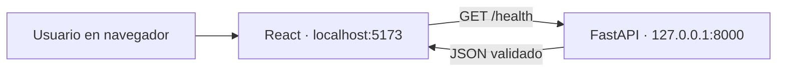

# Arquitectura de FraudGuard AI

## Objetivo y alcance

Proyecto académico de ESCOM-IPN para detectar **anomalías**, no confirmar fraudes. Ejecución local, sin servicios de pago ni datos bancarios reales. Este documento conserva el diseño inicial de fase 1 y las actualizaciones incrementales. La referencia vigente completa es TECHNICAL.md.

## Decisiones

- Monorepositorio en la carpeta actual `FraudGuard`, sin añadir otro nivel `fraudguard-ai`.
- React + Vite + TypeScript + Tailwind CSS para la interfaz; FastAPI + Pydantic para la API.
- Un único backend modular. SQLite con SQLAlchemy se incorporará con los lotes en la fase 2; no se crea una base vacía sin uso.
- Configuración por variables de entorno y archivos `.env` locales; ejemplos versionables sin secretos.
- API en `127.0.0.1:8000`; frontend en `localhost:5173`. CORS permite únicamente los orígenes locales configurados. Los servidores escuchan en la máquina local.
- Dependencias de cada aplicación aisladas. npm conserva `package-lock.json`; Python conserva `requirements.lock.txt` con las versiones verificadas.
- La fase 1 comprueba conectividad real mediante `GET /health`. No presenta métricas, modelos, cargas ni resultados ficticios como implementados.
- La alternativa de un servidor único que sirva también los archivos de React se pospone: dos procesos locales simplifican el desarrollo y respetan el stack solicitado. Se descartan microservicios por el plazo académico.

## Estructura

```text
backend/app/
  api/        # Rutas HTTP; en fase 1, health
  core/       # Configuración
  schemas/    # Contratos Pydantic
  models/     # Reservado para entidades SQLAlchemy
  database/   # Reservado para sesión y persistencia SQLite
  services/   # Reservado para importación y casos de uso
  ml/         # Reservado para pipeline, entrenamiento e inferencia
backend/tests/
frontend/src/
  components/ # Navegación y estado de conexión
  pages/      # Página inicial
  services/   # Cliente HTTP
  hooks/      # Estado y ciclo de vida de la consulta de salud
  types/      # Contrato de la API
datasets/     # Reservado para datos sintéticos
docs/         # Arquitectura, backlog, plan y evidencia
```

## Flujo de la fase 1



Contrato: `200 {"status":"ok","service":"FraudGuard AI","version":"0.1.0"}`. Es una comprobación de disponibilidad del proceso; no certifica una base de datos ni un modelo de ML. La interfaz maneja carga, desconexión, respuesta inválida, tiempo de espera y reintento.

## Flujo posterior previsto, aún no implementado

CSV → límite de tamaño y validación → previsualización → lote SQLite → inferencia con pipeline guardado → resultados persistidos → dashboard.

El entrenamiento estará separado de la inferencia. El preprocesamiento se ajustará solo al conjunto de entrenamiento; las etiquetas se reservarán para evaluación. La frecuencia necesitará una definición temporal que no consulte datos futuros. Se comparará Isolation Forest con una línea base; precision, recall, F1 y matriz de confusión solo se publicarán cuando existan etiquetas válidas. La puntuación normalizada será relativa a una referencia documentada, nunca una probabilidad de fraude. Los niveles de riesgo serán orientativos; no se inventarán explicaciones causales.

## Límites de seguridad actuales

Se valida la configuración, se acotan orígenes CORS y se usan direcciones de loopback. No hay subida de archivos en esta fase. Los controles de tamaño, parser CSV, tipos, persistencia y manejo de errores de importación se probarán con esa funcionalidad. CORS no sustituye autenticación; esta entrega no está preparada para exposición pública.

## Actualización: ingesta y persistencia implementadas

La entrega posterior incorpora ImportBatch y Transaction, SQLite/SQLAlchemy, sesiones por petición y creación/cierre mediante lifespan. Están implementados upload, listado paginado y detalle. El archivo se valida antes de guardar y el guardado completo usa una transacción. El límite ASGI previo al parser incluye la envoltura multipart. La previsualización se devuelve después de persistir. Ver [contrato y decisiones](CSV_IMPORT.md). Las referencias a módulos reservados de persistencia describen la fase 1 histórica; ML continúa reservado.

## Actualización: pipeline ML local

Implementado el pipeline scikit-learn con transformación determinista e Isolation Forest. Entrenamiento, calibración temporal, inferencia y persistencia joblib están separados. Los comandos locales reutilizan el contrato CSV sin modificar SQLite. Ver [modelo, fórmula y limitaciones](ML_MODEL.md) y [plan de etapa](ML_PLAN.md). Las referencias históricas a ML reservado quedan superadas para estos módulos; endpoints ML, evaluación formal e integración de resultados siguen pendientes.

## Actualización: dashboard y persistencia de inferencia

Se añade AnalysisResult como tabla nueva vinculada 1:1 a Transaction, sin alterar tablas existentes. El servidor ofrece train/analyze/status, resumen y niveles en consultas paginadas. React consume API real, conserva la paleta y sidebar existentes y separa cliente HTTP, consultas, importación, tabla y gráficas. Ver [dashboard](DASHBOARD.md) y [plan de etapa](DASHBOARD_PLAN.md). Las referencias históricas a integración pendiente quedan superadas por esta etapa.

## Auditoría final

Ver TECHNICAL.md para esquemas de respuesta explícitos, límites enteros y centavos agregados como cadenas; EVALUATION.md para resultados ejecutados y LIMITATIONS.md para alcance y riesgos. AUDIT.md registra evidencia de pruebas y correcciones; PROGRESS.md conserva la historia.
