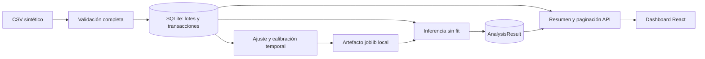

# Referencia técnica de FraudGuard AI

## Componentes y ejecución

Monorepositorio local: React/Vite/TypeScript/Tailwind/Recharts consume FastAPI/Pydantic. SQLAlchemy administra SQLite. scikit-learn/NumPy/pandas/joblib implementan ML. El frontend no calcula puntuaciones ni contiene fixtures de producción. Fuentes y dependencias se sirven localmente después de instalarlas.

Tablas: ImportBatch 1:N Transaction; Transaction 1:0..1 AnalysisResult. Clave foránea activa por conexión; unicidad transaction_id dentro de lote, no entre lotes. Sesión por petición, tablas creadas en lifespan y engine cerrado al apagar. Guardado de lotes y resultados atómico. Joblib usa reemplazo atómico de archivo; el lock del proceso serializa operaciones ML. No hay transacción distribuida entre SQLite y joblib porque entrenar no modifica resultados.

## Contratos

Fuente ejecutable: `/openapi.json` y `/docs`. Respuestas de resumen/modelo/lotes tienen modelos Pydantic explícitos. Modelos TypeScript en frontend/src/types. Los errores tienen detail (string o estructura estándar de validación de FastAPI).

| Método y ruta | Contrato y resultado |
| --- | --- |
| GET /health | 200 status/service/version; solo disponibilidad del proceso. |
| POST /api/transactions/upload | multipart file; 201 batch_id/filename/row_count/preview hasta cinco registros guardados. |
| GET /api/transactions/batches | Lista de lotes por id descendente. |
| GET /api/transactions | items/total/page/page_size; búsqueda literal, batch_id y risk_level opcionales. |
| GET /api/transactions/{id} | Detalle con score/nivel/fecha de modelo o null si pendiente; 404 si no existe. |
| GET /api/dashboard/summary | Conteos, porcentaje sobre analizadas, montos y distribuciones; batch_id opcional. |
| GET /api/ml/status | ready y metadatos o mensaje de indisponibilidad. |
| POST /api/ml/train | JSON batch_id; fit/calibración y archivo local. 200 con metadatos. |
| POST /api/ml/analyze | JSON batch_id; inferencia y commit. 200 con analyzed/model_created_at. |

Ids: entre 1 y 9223372036854775807. Page: 1..1000000000; page_size: 1..100; search: hasta 100 caracteres. Valores fuera de rango se rechazan con 422 antes de llegar a SQLite.

Los agregados `summary.amount_cents` y `daily[].amount_cents` son **cadenas decimales de enteros**, por ejemplo `"9899999999999901"`. Importes por transacción siguen siendo números enteros seguros, acotados por el contrato CSV. El frontend usa BigInt/Intl para formatear sin perder centavos. No convertir agregados a Number.

Códigos: 400 multipart ilegible, 404 entidad inexistente, 409 modelo no disponible para analizar, 413 tamaño, 415 nombre/extensión, 422 entrada/CSV/datos de entrenamiento inválidos y 503 persistencia no disponible. Un batch_id inexistente en resumen/filtros produce conjunto vacío; en acciones train/analyze produce 404. CORS permite GET/POST de orígenes exactos de desarrollo.

## Validación y seguridad

Límite del cuerpo antes de parsear multipart (archivo +64 KiB), límite individual y de filas. Parser CSV estricto UTF-8, columnas únicas/conocidas, montos positivos exactos, fechas con zona y normalización UTC. Nombre saneado sin usarse como ruta. No se guarda el archivo original ni se incluye contenido de filas en errores. Consultas parametrizadas y búsqueda literal con escape de comodines. Las entradas enormes de ids/paginación se validan antes de enlazarlas a SQLite.

Solo modelos locales de confianza: joblib puede ejecutar código y la comprobación de esquema posterior no lo vuelve seguro para artefactos externos. Sin endpoints para subir modelos, bancos, pagos ni autenticación. Uso en loopback; ver LIMITATIONS.md.

## Verificación reproducible

README detalla suites y build. `scripts/audit_http.py` crea servidor Uvicorn real en puerto efímero, DB/modelo temporales; prueba CSV válido/vacío/malformado/grande, OpenAPI, CORS, entrenamiento, análisis, filtros y persistencia tras reinicio de proceso. No toca datos del usuario. Produce docs/audit/http_checks.json. No es una prueba de estrés.

`app.ml.evaluation` produce el informe de EVALUATION.md sin reemplazar el modelo del dashboard. Los tests de UI usan red simulada solo para estados/casos deterministas; la comprobación HTTP y la visual verifican el servidor real.

## Extensión aditiva del dataset

TransactionContext conserva tipo/categoría/ubicación en una tabla nueva 1:0..1 con Transaction, sin alterar datos anteriores. user_id e is_anomaly se adaptan a account_id/label. El esquema de transacciones añade campos opcionales para consultar la referencia y el contexto. Los atributos de entrada de ML siguen siendo exclusivamente los definidos en features.py. Ver DATASET_DEMO.md. La exportación OpenAPI de la auditoría anterior es una instantánea histórica; /openapi.json publica los campos actuales al reiniciar.
